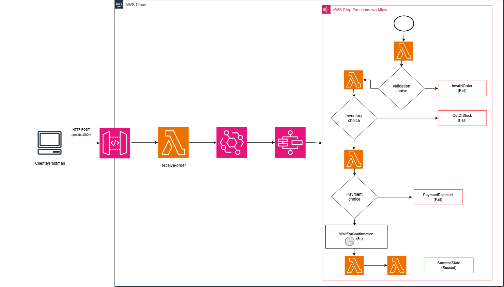
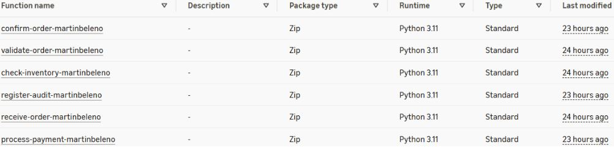
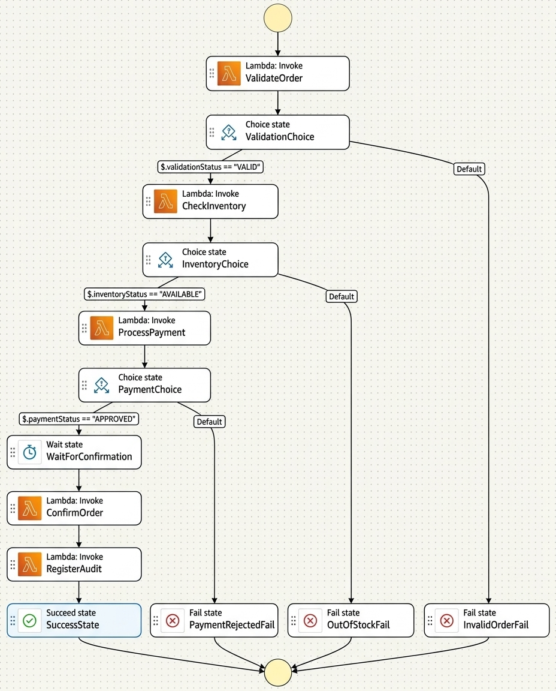

# Laboratorio: Automatización de pedidos con API Gateway, EventBridge y Step Functions

Un pedido enviado por HTTP se publica como evento en EventBridge y dispara un flujo en Step Functions que lo valida, revisa inventario, cobra, confirma y audita.



## Servicios

| Servicio | Qué hace |
|---|---|
| **API Gateway** (HTTP API) | Recibe `POST /pedido` |
| **Lambda `receive-order`** | Genera el `orderId` y publica el evento en EventBridge |
| **EventBridge** | Regla que captura `NuevoPedido` y lanza Step Functions |
| **Step Functions** (Standard) | Orquesta todo el proceso |
| **Lambdas del flujo** | `validate-order`, `check-inventory`, `process-payment`, `confirm-order`, `register-audit` |

## Flujo

1. El cliente hace `POST /pedido` con los datos del pedido.
2. `receive-order` publica el evento `NuevoPedido` en EventBridge.
3. La regla inicia una ejecución de Step Functions.
4. El flujo pasa por las validaciones:
   - **Validación:** cliente y producto no vacíos, `cantidad > 0`, `total > 0`. Si falla → `InvalidOrderFail`.
   - **Inventario:** `cantidad <= 5` hay stock. Si no → `OutOfStockFail`.
   - **Pago:** `total <= 1000` se aprueba. Si no → `PaymentRejectedFail`.
5. Espera 5 segundos, confirma el pedido y registra la auditoría → `Succeed`.

## Cómo probarlo

Envía un `POST` a `https://<API_ID>.execute-api.us-east-1.amazonaws.com/pedido` con este body:

```json
{
  "cliente": "Johan",
  "producto": "Laptop",
  "cantidad": 1,
  "total": 900
}
```

Luego revisa la ejecución en **Step Functions → Executions**.

| Caso | Body | Resultado esperado |
|---|---|---|
| Pedido válido | `cantidad: 1`, `total: 900` | `Succeeded` |
| Pago rechazado | `cantidad: 1`, `total: 1500` | `Failed` en `PaymentRejectedFail` |
| Sin inventario | `cantidad: 10`, `total: 900` | `Failed` en `OutOfStockFail` |
| Pedido inválido | `cliente: ""` | `Failed` en `InvalidOrderFail` |

## Evidencias

**Lambdas creadas**



**Step Function**



**Ejecución exitosa** (Details, Graph view y Table view): [Ver evidencias en PDF](evidencias/Evidencias.PDF)

## Notas

- El enunciado dice que el pago se rechaza si `cantidad > 1000`, pero el código evalúa `total`. Este README sigue el código.
- API Gateway responde `200` al recibir el pedido, aunque después el flujo falle. El resultado real está en Step Functions.
- Reemplaza `<API_ID>`, `<ACCOUNT_ID>` y `<nombre>` por tus valores.

## Estructura del repositorio

```
.
├── README.md
├── arquitectura-step-functions.png
└── evidencias/
    ├── lambdas.jpg
    ├── step-function.jpeg
    └── Evidencias.PDF
```
